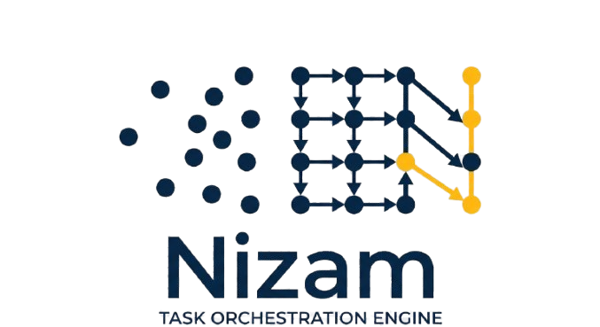

<div align="center" style="background-color: white; padding: 20px; border-radius: 10px; display: inline-block;">
    
    <h1>Nizam</h1>
</div>

- Nizam is an Arabic word that means "system" or "order" — and that's exactly what this engine does: you can run complicated commands with their dependencies, with strong control and readable logging.

## Requirements
- python3
- pip
- rustup (cargo, rustc, ...)

## Setup & run

```console
python -m venv .venv
source .venv/bin/activate
pip install maturin
./run.sh
```

## Tests

```console
cargo test
```
